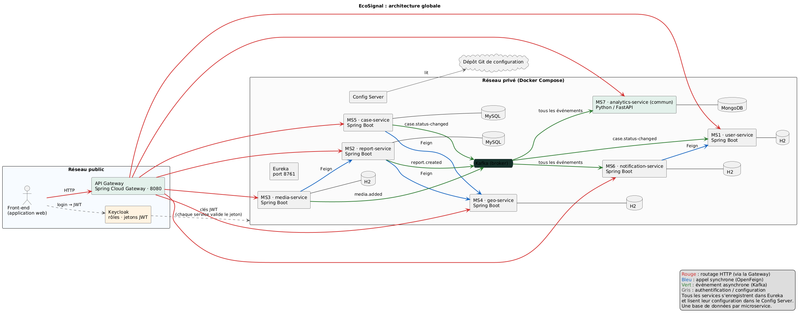

# EcoSignal

Application web de signalement citoyen des pollutions et décharges sauvages en Tunisie, avec suivi du traitement par les municipalités.
Mini-projet AWD 2026-2027 (architecture microservices, Spring Cloud).

## Équipe

| Nom et prénom | Microservice |
| --- | --- |
| Aymen Raddedi | MS1 – user-service |
| Marwan Azaiz | MS2 – report-service |
| Rayen ben chtila | MS3 – media-service |
| Aziz Gasmi | MS4 – geo-service |
| Hamza Jlassi | MS5 – case-service |
| Mohamed islem Mnakbi | MS6 – notification-service |
| Tout le groupe | MS7 – analytics-service (microservice commun, Python / FastAPI) |

Classe / groupe : 4SSA1-G6
Outil de gestion de projet : [GitHub Projects](https://github.com/users/aymenRaddedi/projects/8)

## Sujet

Le citoyen signale une pollution (catégorie, description, photo, position GPS). Le signalement est rattaché à une commune, un dossier est créé pour la municipalité, le citoyen est notifié à chaque étape et gagne des points lorsque le signalement est résolu. L'administrateur consulte les statistiques et les zones les plus touchées.

Acteurs : citoyen (`CITIZEN`), agent municipal (`MUNICIPAL_AGENT`), administrateur (`ADMIN`).

## Microservices

| Service | Responsabilité | Technologie | Base |
| --- | --- | --- | --- |
| user-service | Profils, commune de rattachement, points de réputation | Spring Boot | H2 |
| report-service | Cycle de vie d'un signalement | Spring Boot | MySQL |
| media-service | Photos liées aux signalements | Spring Boot | H2 |
| geo-service | Communes, zones, rattachement d'une position GPS | Spring Boot | H2 |
| case-service | Dossiers municipaux, agents, statuts, commentaires | Spring Boot | MySQL |
| notification-service | Notifications et historique | Spring Boot | H2 |
| analytics-service | Statistiques et zones à risque | Python / FastAPI | MongoDB |

Une base par microservice, aucune base partagée.

## Architecture

Front-end → API Gateway (Spring Cloud Gateway) → microservices (Spring Boot, et Python pour analytics-service).
Infrastructure : Eureka (découverte), Config Server, Keycloak (authentification et rôles), broker de messages pour les événements asynchrones (Kafka, à confirmer), Docker Compose.

Communication :
- synchrone (OpenFeign) : report → geo, media → report, notification → user, case → geo ;
- asynchrone : `report.created`, `case.status-changed`, `media.added`.



Diagrammes (dossier `Documentation/Diagrams/`) :
- `architecture-globale.png` : architecture globale ;
- `diagramme-classes-par-domaine.png` : classes par domaine (un domaine = un microservice) ;
- `sequence-signalement.png` : parcours d'un signalement, avec le cas de panne ;
- `classes-<service>.png` : diagramme de classes de chaque microservice.

## Structure du dépôt

```
ecosignal-4SSA1/
├── Backend/
│   ├── eureka/
│   ├── gateway/
│   └── microservices/
│       ├── user-service/
│       ├── report-service/
│       ├── media-service/
│       ├── geo-service/
│       ├── case-service/
│       ├── notification-service/
│       └── analytics-service/
├── Frontend/
├── Documentation/
│   ├── Presentation/
│   └── Diagrams/
└── README.md
```

## Lancement

État actuel (Validation 1) : le projet de chaque microservice est créé dans `Backend/microservices/`, compile et démarre individuellement avec un endpoint de test. La logique métier, la Gateway, Eureka et le Config Server arrivent à partir de la séance 5, Docker Compose en séance 9.

Prérequis : JDK 17 (Maven est fourni par le wrapper `mvnw`), Python 3.11 ou plus pour analytics-service.

| Service | Port | Endpoint de test |
| --- | --- | --- |
| user-service | 8081 | `GET /hello` |
| report-service | 8082 | `GET /hello` |
| media-service | 8083 | `GET /api/media/hello` |
| geo-service | 8084 | `GET /hello` |
| case-service | 8085 | `GET /hello` |
| notification-service | 8086 | `GET /hello` |
| analytics-service | 8087 | `GET /hello` |

Lancer un service Spring Boot :

```
cd Backend/microservices/<nom-du-service>
./mvnw spring-boot:run
```

Sous Windows : `mvnw.cmd spring-boot:run`. media-service embarque déjà le client Eureka : tant que le serveur Eureka n'est pas en place (S5), il démarre normalement mais affiche des avertissements de connexion au port 8761.

Lancer analytics-service (Python / FastAPI) :

```
cd Backend/microservices/analytics-service
python -m venv .venv
.venv\Scripts\activate          # Linux / macOS : source .venv/bin/activate
pip install -r requirements.txt
uvicorn app.main:app --port 8087
```

Page de test du front-end (appelle l'endpoint de test des sept services) :

```
cd Frontend
python -m http.server 5500
```

puis ouvrir `http://localhost:5500`.

Prévu pour la version finale :

```
docker compose up --build
```

- API Gateway : port 8080
- Eureka : port 8761
- Keycloak et Swagger de chaque service : à documenter

## Documentation

- Dossier technique (sujet, acteurs, découpage, données, interactions, architecture, contrats d'API, planning) : `Documentation/EcoSignal-Dossier-technique-Validation-1.docx`
- Présentation : `Documentation/Presentation/EcoSignal-Presentation.pdf`
- Diagrammes : `Documentation/Diagrams/`

## Organisation Git

Une branche par fonctionnalité, fusion par pull request relue par un autre membre. Commits réguliers de chaque membre.
